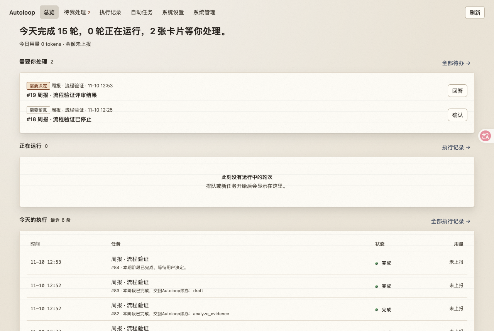
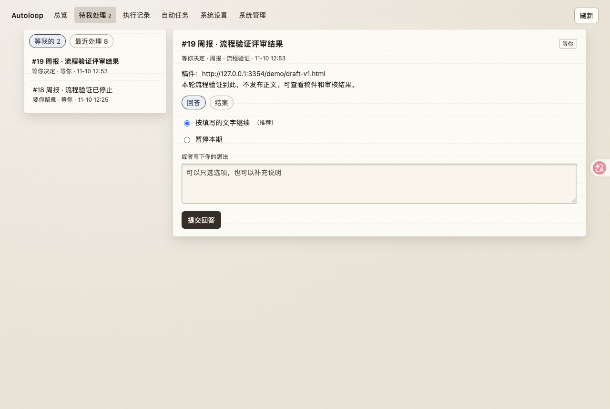
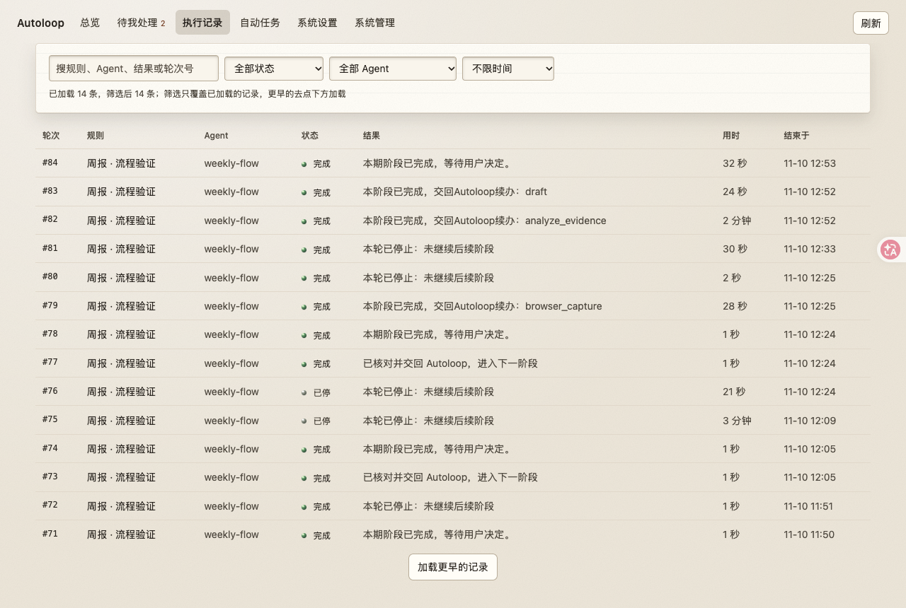
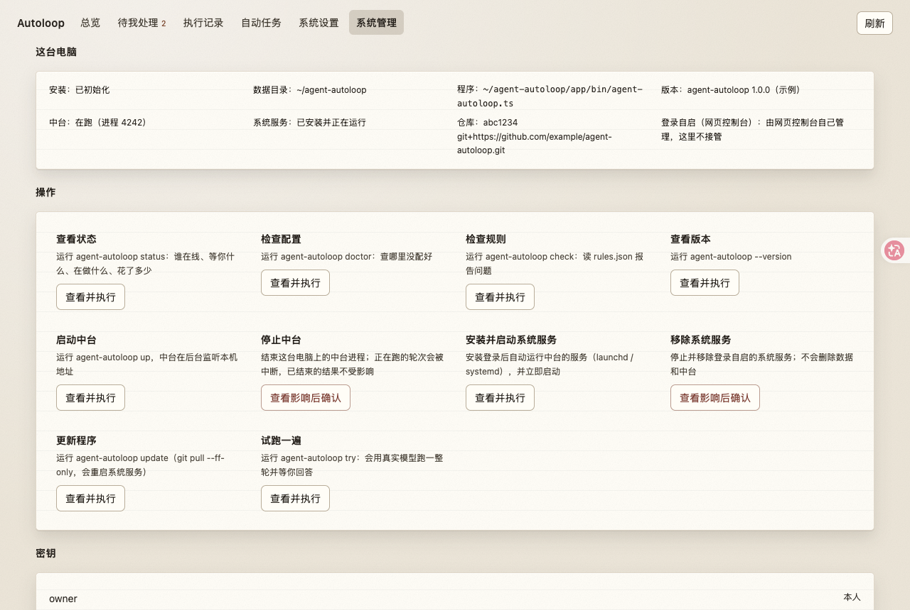

# dsh-autoloop

**Agent Autoloop 的 DeepSeek Harness 侧栏插件。** 在 dsh 里看每一轮跑得怎么样、处理等你决定的卡片、改自动任务规则，不用再切换终端或浏览器标签。

[](./LICENSE)
[](./package.json)
[](https://github.com/deepseek-ai/deepseek-harness)

> **这个插件和上游项目是什么关系**
>
> [Agent Autoloop](https://github.com/KKKKhazix/agent-autoloop) 是**数字生命卡兹克**开源的自动化中台（MIT 许可），本身已经能跑。它定位是"没有后台界面"——需要你拍板时把卡片推到飞书、钉钉或桌面通知。
>
> 本项目**不是它的分支，也不重新分发它的代码**。这里只做了两件事：
>
> 1. 一个 dsh 插件，把中台的数据和操作搬进 dsh 侧栏；
> 2. 给这套界面设计了一套拟物材质主题。
>
> 你仍然需要先安装并运行上游的 Agent Autoloop 中台。详细署名见 [NOTICE](./NOTICE)。

---

## 截图

| 总览 | 待我处理 |
|---|---|
|  |  |

| 执行记录 | 系统管理 |
|---|---|
|  |  |

> 截图待补：请把运行时截图放到 `docs/images/`，文件名与上表一致。

## 功能

| 页面 | 内容 |
|---|---|
| **总览** | 一句话摘要：今天完成几轮、几轮在跑、几张卡片等你；待办、运行中、最近执行、规则一览 |
| **待我处理** | 卡片正文与证据、选项或自由回答、结案。**回答会唤醒 Agent，结案不会**，两个按钮分开 |
| **执行记录** | 按状态 / Agent / 时间筛选，分页加载更早；详情含事件、结果、用量、时间线，可停在跑的轮次 |
| **自动任务** | 规则增改、事件 or 定时触发、停用进存档、从存档恢复 |
| **系统设置** | 连接检查、Agent 与通道在线状态、发一条通知 |
| **系统管理** | 状态 / 检查 / 启停中台 / 系统服务 / 更新 / 试跑，每个动作先说明影响再确认 |

## 它怎么工作

dsh 插件是**双半侧**结构，这个项目也一样：

```
dsh 浏览器面板（React bundle）
  └─ sidebar.panellist 图标 + main 面板 ── fetch('/api/autoloop/*')
dsh 宿主侧（Node，Cordis 插件）
  ├─ config.ts   只读 ~/.agent-autoloop/config.json（owner 密钥只留在这里）
  ├─ hub.ts      /v1/state · cards · runs · cancel · tell 的 HTTP 客户端
  ├─ rules.ts    rules.json 读写（与网页控制台同一套 revision / 存档 / 备份）
  ├─ actions.ts  固定白名单动作 + 确认令牌 + 后台任务
  └─ routes.ts   /api/autoloop/* 一份一份 Envelope
```

**密钥不出宿主**：`config.json` 里的 owner 密钥只在 Node 侧使用，浏览器只拿到数据，永远看不到密钥。

## 和官方网页控制台的关系

Agent Autoloop 自带的网页控制台（`agent-autoloop-ui`，默认 `127.0.0.1:3351`）和这个插件**并行存在，互不接管**：

| | 网页控制台 | 这个插件 |
|---|---|---|
| 入口 | 浏览器开 `127.0.0.1:3351` | dsh 侧栏「自动循环」 |
| 中间层 | 它自带的适配服务 | dsh 宿主路由 |
| `config.json` | 读 | 只读，不写不搬 |
| `rules.json` | 写 | 写，算法一致：同样 revision、同样存档文件、写前备份、原子替换 |
| 登录自启 | 自己管理 | 不碰 |

两边算的是**同一个 revision**，所以一方改了规则，另一方能正确识别冲突，不会互相覆盖。

## 安装

前提：已经装好并运行了 [Agent Autoloop](https://github.com/KKKKhazix/agent-autoloop)，`~/.agent-autoloop/config.json` 存在。

```bash
git clone https://github.com/Minggnim-jpg/dsh-autoloop.git
cd dsh-autoloop
npm install
npm run build
```

然后在 dsh 里安装这个本地包：

```bash
# 桌面应用：用 dsh 的插件管理装，cli 不能直接改 desktop profile
dsh plugin --profile web add --save-prod file:$PWD
```

桌面应用请在 **设置 → 插件** 里安装，或使用插件管理能力：

```
install_bundle file:/绝对路径/dsh-autoloop
```

装好后刷新页面，侧栏出现「自动循环」。

## 开发

```bash
npm run build       # 同时产出 lib/index.js（宿主）和 lib/client.js（浏览器）
npm run dev         # 监听改动
npm run typecheck   # 宿主侧类型检查
npm test            # rules.json 的读、冲突、存档、恢复、校验
node scripts/dev-harness.mjs 3999   # 把宿主路由挂到临时端口，用 curl 试
```

`scripts/dev-harness.mjs` 读的是真实的 `~/.agent-autoloop`，只做读取和校验；不要在上面点"确认执行"。

## 设计

界面是**拟物材质**方向：云橡木桌面 + 横线纸面区块 + 墨色胶木主按钮。配色在四个候选里选定了 **A3「云橡木」**——桌面和纸面明度接近，靠光影和纹理分层，而不是靠色差。

- 全部颜色是 `alo-` 前缀的局部变量，不污染 dsh 其他界面。
- 深色跟随 dsh 的 `body[data-ds-dark-theme]`，不新增独立主题状态。
- 支持 `prefers-reduced-motion`。

## 发版

```bash
npm run release -- 0.3.0          # 改版本、写入索引、提示后续步骤
npm run release -- 0.3.0 --dry-run  # 只看会改什么

# 按提示填 CHANGELOG、构建、测试、提交并打 tag
git push origin main && git push origin v0.3.0

npm run release -- --pin 0.3.0    # 把索引里的 commit 补成真实 SHA
git add market/index.json && git commit -m "release: pin v0.3.0" && git push
```

`--pin` 是单独一步，因为索引需要的是**这次发布自己的 commit**，而提交索引这个动作才会产生它。`--pin` 之前索引里的 `commit` 是空的——空的装不上，好过填一个假的让人以为能装。

脚本会用 dsh 自带的校验器（`@deepseek-ai/dsh-plugin-market-index`）验证索引格式。找不到校验器时会跳过并提示，可用 `DSH_MARKET_INDEX_VALIDATOR` 指定路径。

## 插件市场

本仓库提供了一个符合 **Plugin market index format 1** 的索引文件：

```
https://raw.githubusercontent.com/Minggnim-jpg/dsh-autoloop/main/market/index.json
```

在 dsh 里启用「自定义插件索引」后填入上面的地址即可浏览和安装。

索引格式由 `@deepseek-ai/dsh-plugin-market-index` 定义：`format: 1`，每个版本必须带 `source`——npm 包名，或 git 仓库加一个钉死的 40 位 commit。`title` 和 `description` 是多语言对象且必须含 `en`。

## 许可

MIT。本插件本体是 Minggnim-jpg 的作品；对接的 Agent Autoloop 归数字生命卡兹克所有，同 MIT 许可。详见 [LICENSE](./LICENSE) 和 [NOTICE](./NOTICE)。
